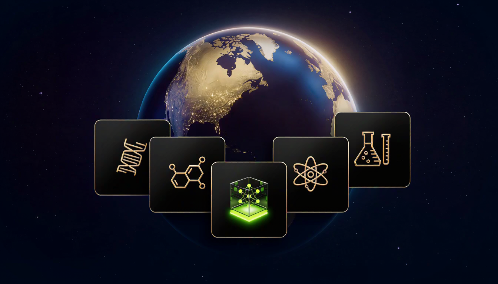

<p align="center">
  
</p>

<h1 align="center">NVIDIA Nemotron for Science</h1>

<p align="center">
  <a href="https://huggingface.co/nvidia/NVIDIA-Nemotron-3.5-Super-VL-120B-A12B-BF16"></a>
  
  
</p>

<p align="center">
  NVIDIA Nemotron 3.5 Super VL is a vision-language model for reasoning over scientific documents and figures, generating research code, and calling computational tools.
</p>

<p align="center">
  <a href="https://huggingface.co/nvidia/NVIDIA-Nemotron-3.5-Super-VL-120B-A12B-BF16">Model card</a> ·
  <a href="https://huggingface.co/nvidia/NVIDIA-Nemotron-3.5-Super-VL-120B-A12B-BF16/tree/main">Model weights</a> ·
  <a href="https://nvidianews.nvidia.com/news/nvidia-introduces-nemotron-for-science-to-accelerate-discoveries-with-agents">NVIDIA announcement</a> ·
  <a href="#quick-start">Quick start</a>
</p>

## About Nemotron for Science

NVIDIA introduced Nemotron for Science at SC26 to help researchers build specialized agents for scientific discovery. The initiative pairs Nemotron 3.5 Super VL with an open chemistry dataset and post-training recipes. Researchers can adapt the model to their field and connect agents to CUDA-X accelerated tools for computational work. [NVIDIA announcement](https://nvidianews.nvidia.com/news/nvidia-introduces-nemotron-for-science-to-accelerate-discoveries-with-agents)

## Model at a glance

| Feature | NVIDIA Nemotron 3.5 Super VL |
| --- | --- |
| Checkpoint | `NVIDIA-Nemotron-3.5-Super-VL-120B-A12B-BF16` |
| Parameters | 120B total, 12B active |
| Architecture | Hybrid Mamba-2 and Transformer mixture-of-experts with a C-RADIO vision encoder |
| Inputs and output | Text, images, and video in. Text out. |
| Context window | Up to 1 million tokens, depending on deployment settings |
| BF16 use cases | Customization, domain adaptation, and evaluation with reference weights |
| Model license | OpenMDW 1.1 |

See the [Hugging Face model card](https://huggingface.co/nvidia/NVIDIA-Nemotron-3.5-Super-VL-120B-A12B-BF16) for benchmark results and model terms.

## Quick start

1. Follow NVIDIA’s [vLLM quick start](https://huggingface.co/nvidia/NVIDIA-Nemotron-3.5-Super-VL-120B-A12B-BF16#quick-start) to serve the BF16 checkpoint. The example uses Docker with NVIDIA GPU support and four H100 GPUs.
2. Once the server is ready, send a text request to its local endpoint.

   ```bash
   curl --fail http://localhost:8000/v1/chat/completions \
     -H 'Content-Type: application/json' \
     --data '{
       "model": "nemotron-3.5-super-vl",
       "messages": [
         {
           "role": "user",
           "content": "Explain how to read a residual plot and what patterns indicate a poor fit."
         }
       ],
       "max_tokens": 512
     }'
   ```

3. To send a figure or video along with a prompt, see NVIDIA’s [multimodal API examples](https://huggingface.co/nvidia/NVIDIA-Nemotron-3.5-Super-VL-120B-A12B-BF16#api-client).
